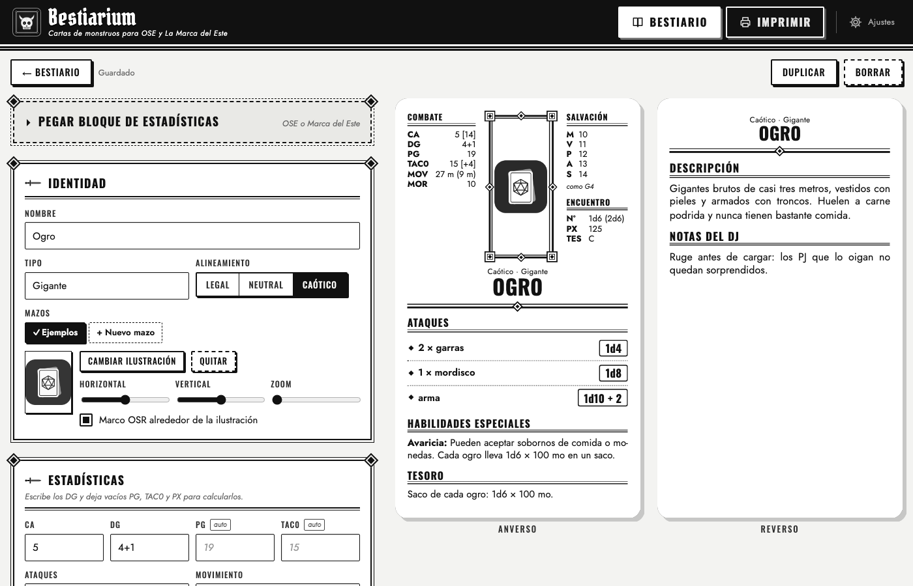
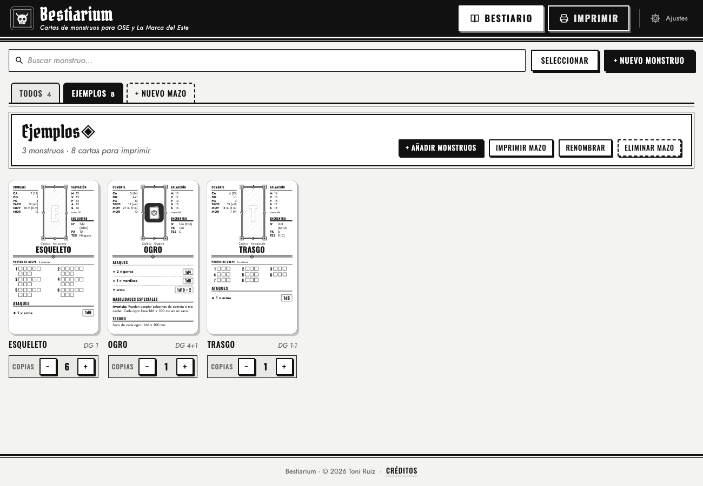
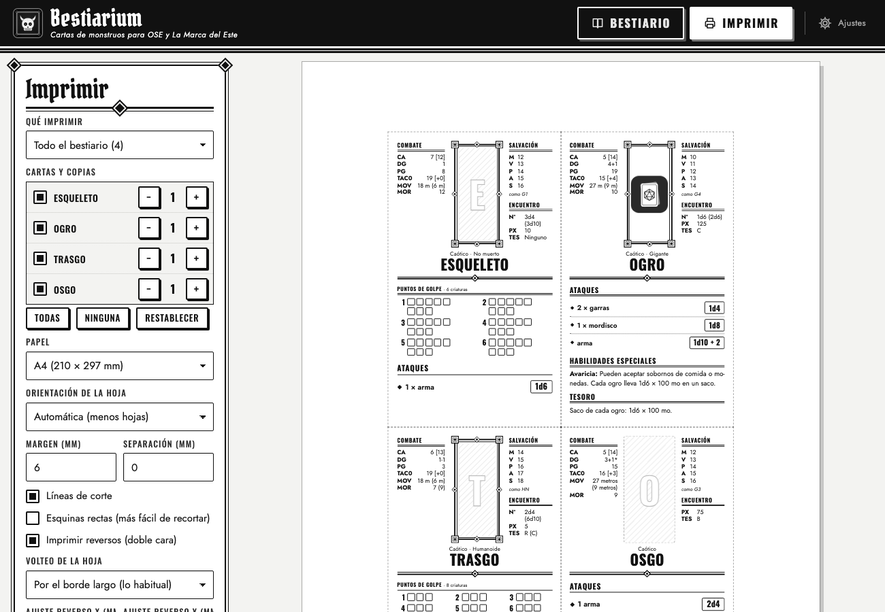

# Bestiarium

Cartas de monstruos tamaño tarot (70 × 120 mm), con anverso y reverso, para **Old-School Essentials** y
**Aventuras en la Marca del Este**. Es una app web instalable (PWA) que funciona sin conexión en el móvil y en el
ordenador. No necesita servidor, cuenta ni compilación.



## Funciones

- **Formulario con el bloque de monstruo de OSE / La Marca del Este:** CA, DG, PG, TAC0, movimiento, moral, salvaciones
  (M V P A S), número de aparición, PX y tesoro.
- **Cálculo automático con las tablas B/X:** con los DG obtienes PG medios, TAC0 [bonificador], salvaciones (como
  guerrero de su nivel, o como humano normal por debajo de 1 DG) y PX (cada asterisco suma el bonus de habilidad
  especial). Si escribes un valor a mano, ese manda.
- **Pegar bloque de estadísticas:** acepta la línea de OSE en inglés (`AC 6 [13], HD 1-1 (3hp), Att…`) y el formato
  por líneas de La Marca del Este (`Clase de armadura: 6`…). Las líneas que empiezan por ▶, • o - se convierten en
  habilidades especiales.
- **Carta con anverso y reverso:**
  - **Anverso (combate):** estadísticas, ilustración con marco opcional, nombre, ataques con el daño destacado,
    habilidades especiales y tesoro.
  - **Casillas de PG opcionales:** una fila por criatura, repartidas en 1–3 columnas según los PG. Si las activas, las
    habilidades y el tesoro pasan al reverso.
  - **Reverso:** descripción y notas del DJ.
  - **Ajuste del texto:** el tamaño de letra se adapta solo para que todo quepa.
- **Mazos:** un mazo es una lista de monstruos con el número de copias de cada uno, y un monstruo puede estar en
  varios mazos.
- **Impresión:** a doble cara en A4, Carta o A3, con 4 cartas por hoja A4 y reversos colocados en espejo para el
  volteo. Eliges qué cartas y cuántas copias, y hay líneas de corte y ajuste fino X/Y del reverso.
- **Datos:** se guardan en el dispositivo (IndexedDB) y se exportan o importan en JSON para hacer copias o pasar
  monstruos entre dispositivos.
- **Tutorial:** se muestra la primera vez que abres la app y puedes volver a verlo desde Ajustes.

| Mazos | Impresión |
|---|---|
|  |  |

## Uso

### Probar en local

No hay dependencias: basta con servir la carpeta.

```bash
python3 -m http.server 8080
# abre http://localhost:8080
```

> Si abres `index.html` directamente como archivo (`file://`), el modo sin conexión no funciona: hace falta un
> servidor.

### Publicar (para usarla en el móvil)

El modo sin conexión necesita **HTTPS**. Con GitHub Pages:

1. Sube el repositorio a GitHub.
2. Ve a *Settings → Pages → Build and deployment*, elige *Deploy from a branch* y selecciona la rama `main`, carpeta
   `/ (root)`.
3. Abre la URL en el móvil e instala la app: en Android/Chrome, menú ⋮ → «Instalar aplicación»; en iPhone/Safari,
   Compartir → «Añadir a pantalla de inicio».

También sirven Netlify, Cloudflare Pages o cualquier hosting estático.

**Al publicar cambios**, sube el número de `VERSION` en `sw.js` para que los dispositivos instalados descarguen la
versión nueva.

### Imprimir bien

- En el diálogo de impresión usa escala **100 %** («Tamaño real») y **sin márgenes**.
- Para doble cara, elige el volteo por el **borde largo**. Si el reverso sale desplazado, corrígelo con «Ajuste
  reverso X/Y».
- Desde el móvil puedes «Guardar como PDF» e imprimir después.

## Estructura

```
index.html              Página única de la app
manifest.webmanifest    Manifiesto PWA
sw.js                   Service worker (caché para uso sin conexión)
css/
  app.css               Interfaz
  cards.css             Diseño de la carta (medidas en mm)
  print.css             Hojas de impresión
  fonts.css             @font-face de las fuentes locales
js/
  app.js                Arranque y rutas (#/, #/edit/:id, #/print, #/settings, #/credits)
  model.js              Modelo de monstruo y tablas B/X (TAC0, salvaciones, PX, PG)
  render.js             HTML del anverso y el reverso
  fit.js                Ajuste automático del tamaño de letra
  parse.js              Lector de bloques de estadísticas pegados
  decks.js              Mazos y copias
  store.js              IndexedDB
  io.js                 Importar / exportar JSON
  tutorial.js           Tutorial de bienvenida
  credits.js            Datos de los créditos (edítalos aquí)
  views/                Biblioteca, editor, impresión, ajustes y créditos
fonts/                  Oswald, Jost y Pirata One (woff2) y sus licencias
icons/                  Icono de la app (SVG y PNG)
docs/                   Capturas para este README
```

## Formato de exportación

```json
{
  "app": "bestiarium",
  "version": 3,
  "monsters": [{ "id": "…", "name": "Ogro", "hd": "4+1", "ac": "5", "attacks": "1 × garrote (1d10)", "…": "…" }],
  "decks": [{ "id": "…", "name": "La cripta", "entries": [{ "id": "<id del monstruo>", "count": 2 }] }]
}
```

## Licencia

- **Código:** [MIT](LICENSE).
- **Fuentes:** [SIL Open Font License 1.1](fonts/licenses/): Oswald (The Oswald Project Authors), Jost (The Jost
  Project Authors) y Pirata One (Rodrigo Fuenzalida y Nicolás Massi).

## Aviso

Proyecto de aficionado, no oficial y sin afiliación. *Old-School Essentials* es marca de Necrotic Gnome; *Aventuras
en la Marca del Este* y el resto de marcas citadas pertenecen a sus respectivos propietarios. Los monstruos de ejemplo
usan mecánicas genéricas B/X con descripciones originales.
